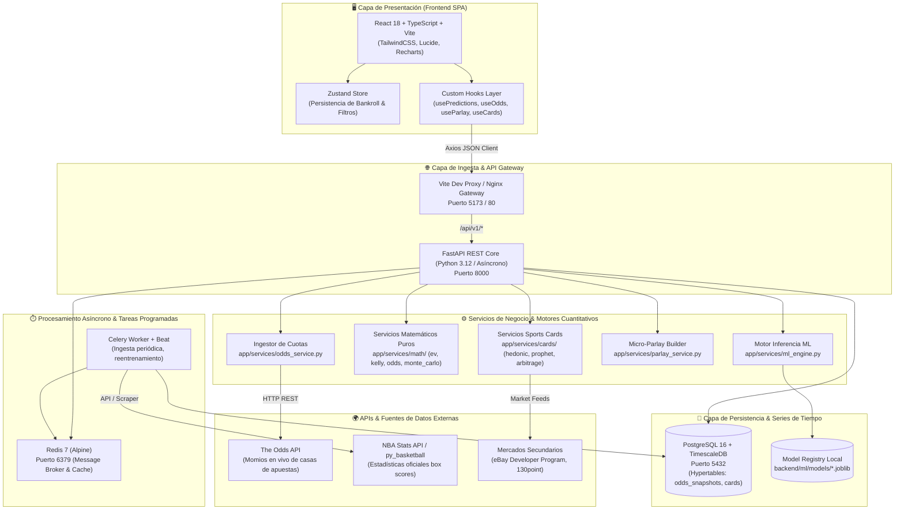
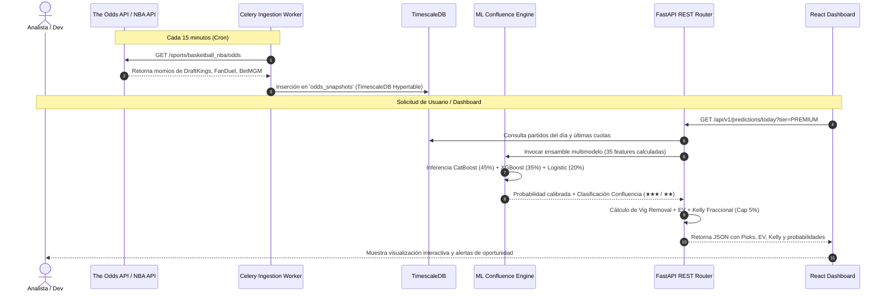

# 🏛️ Arquitectura del Sistema — Sports Analytics Platform

**Versión:** 2.0.0  
**Fecha:** Septiembre 2026  
**Stack Principal:** FastAPI · TimescaleDB (PostgreSQL 16) · Redis · Celery · React 18 · TypeScript · Vite · TailwindCSS  

---

## 1. 🌟 Visión General y Filosofía de Diseño

La **Sports Analytics Platform** es un ecosistema cuantitativo distribuido, de alta concurrencia y bajo acoplamiento, enfocado en dos pilares:
1. **Modelado Deportivo de Apuestas con Valor Esperado Positivo (+EV):** Ingesta en tiempo real de cuotas de casas de apuestas deportivas, eliminación de margen de la casa (*vig removal*), inferencia estadística de confluencia multimodelo (CatBoost + XGBoost + Regresión Logística) y optimizador combinatorio de *micro-parlays*.
2. **Sports Card & NIL Analytics:** Valuación hedónica de tarjetas coleccionables deportivas (NBA y contratos universitarios NCAA NIL), modelado de series temporales con Prophet para predecir curvas de depreciación ("Efecto Uniforme") y detector de anomalías de precio (arbitraje en mercados secundarios como eBay).

### Principios Rectores:
* **Single Responsibility Principle (SRP):** Cada módulo, clase y función realiza una única tarea matemática o de negocio bien acotada y testeable de forma aislada.
* **Human-in-the-Loop:** El sistema **no** es una caja negra impenetrable. Está diseñado para que analistas cuantitativos y desarrolladores puedan auditar, calibrar pesos, modificar umbrales de Kelly y simular escenarios manualmente.
* **Separación Estricta de Capas:** El frontend jamás consume directamente bases de datos ni servicios externos de scraping; todo fluye a través de una API REST tipada bajo estándares OpenAPI v3.

---

## 2. 🗺️ Diagrama de Arquitectura Global (C4 - Nivel de Contenedores)



---

## 3. 🔄 Flujo del Pipeline de Datos (Data Pipeline Lifecycle)

El ciclo de vida del dato sigue un flujo unidireccional y predecible:



---

## 4. 🧩 Justificación del Stack Tecnológico

| Componente | Elección | Justificación Técnica & Ventaja Competitiva |
|---|---|---|
| **Lenguaje Backend** | **Python 3.12** | Ecosistema inigualable para Data Science y ML (`scikit-learn`, `catboost`, `xgboost`, `prophet`, `pandas`). Permite unir en el mismo proceso la API web y los pipelines matemáticos de alta precisión sin necesidad de puentes interlenguaje. |
| **Framework API** | **FastAPI** | Altísima velocidad asíncrona basada en Starlette y Pydantic v2. Autogeneración de documentación OpenAPI/Swagger interactiva y tipado estricto de requests y responses. |
| **Base de Datos** | **PostgreSQL 16 + TimescaleDB** | TimescaleDB transforma PostgreSQL en una base de datos de series temporales de alto rendimiento mediante *hypertables*. Ideal para registrar fluctuaciones de momios de apuestas milisegundo a milisegundo y cotizaciones históricas de tarjetas deportivas. |
| **Cache & Colas** | **Redis 7 + Celery** | Permite desacoplar las tareas lentas de scraping y recolección de cuotas de las peticiones HTTP del usuario, evitando timeouts y asegurando resiliencia. |
| **Frontend Framework** | **React 18 + Vite** | Tiempos de arranque y Hot Module Replacement (HMR) ultrarrápidos (<500ms). Modularidad basada en componentes y tipado estricto en TypeScript. |
| **Visualización** | **Recharts** | Representación reactiva en SVG de series temporales (curvas de depreciación Prophet y bandas de incertidumbre) integrada nativamente con el ciclo de vida de React. |
| **Estilos** | **TailwindCSS** | Diseño moderno de interfaz oscura ("Dark Mode High-Contrast") enfocada en terminales cuantitativos financieros tipo Bloomberg. |

---

## 5. 📂 Desglose Modular y Arquitectura de Carpetas

La arquitectura implementa separación estricta de responsabilidades (SRP). Cada carpeta tiene un propósito inmutable:

```
sports_analytics/
├── AI_CONTEXT_PROTOCOL.md          # Protocolo de memoria compartida entre agentes IA y humanos
├── docker-compose.yml              # Orquestación de contenedores (DB, Redis, API, Celery)
├── .env.example                    # Plantilla de variables de entorno de producción y desarrollo
│
├── docs/                           # SUITE DE DOCUMENTACIÓN TÉCNICA
│   ├── ARCHITECTURE.md             # Este documento (Diseño global y C4)
│   ├── ONBOARDING_DEV.md           # Guía paso a paso para nuevos desarrolladores
│   ├── QUANT_MANUAL.md             # Fundamentos matemáticos (EV, Vig, Kelly, Confluencia)
│   └── SPORTS_CARDS_GUIDE.md       # Modelo hedónico y depreciación de cartas NIL
│
├── backend/                        # NÚCLEO DEL SERVIDOR Y MODELOS MATEMÁTICOS
│   ├── Dockerfile                  # Contenedor optimizado en python:3.12-slim
│   ├── requirements.txt            # Dependencias fijadas y verificadas
│   ├── app/
│   │   ├── main.py                 # Punto de entrada FastAPI, middlewares CORS y lifespan
│   │   ├── core/
│   │   │   ├── config.py           # Configuración con Pydantic Settings (.env)
│   │   │   └── database.py         # Pool de conexiones asíncrono con SQLAlchemy 2.0
│   │   ├── models/                 # Modelos ORM relacionales
│   │   │   ├── team.py             # Entidad de equipos (NBA, NFL, NCAA)
│   │   │   ├── game.py             # Partidos, fechas, estatus y resultados
│   │   │   ├── odds.py             # Snapshots de momios por casa de apuestas
│   │   │   ├── prediction.py       # Registro histórico de inferencias emitidas
│   │   │   ├── bankroll.py         # Ledger de transacciones y auditoría de capital
│   │   │   └── card.py             # Tarjetas deportivas, atributos y valuaciones
│   │   ├── services/
│   │   │   ├── math/               # ── MÓDULOS MATEMÁTICOS PUROS (Sin dependencias de I/O)
│   │   │   │   ├── odds_converter.py   # Conversión American/Decimal/Probabilidad & Sin Margen
│   │   │   │   ├── kelly.py            # Criterio de Kelly fraccional con caps de seguridad
│   │   │   │   ├── ev.py               # Fórmulas de EV puro y lógica de tickets
│   │   │   │   └── monte_carlo.py      # Simulador estocástico de trayectorias de bankroll
│   │   │   ├── cards/              # ── MÓDULOS DE VALUACIÓN DE ACTIVOS DEPORTIVOS
│   │   │   │   ├── multipliers.py      # Tablas paramétricas de efecto uniforme, grados y rareza
│   │   │   │   ├── hedonic_pricing.py  # Calculador de Fair Market Value (FMV)
│   │   │   │   ├── arbitrage_detector.py # Detector de anomalías netas de comisión
│   │   │   │   └── prophet_forecaster.py # Proyector de series temporales (90 días)
│   │   │   ├── ml_engine.py        # Inferencia en vivo con ensamble de modelos entrenados
│   │   │   ├── odds_service.py     # Cliente HTTP hacia The Odds API
│   │   │   └── parlay_service.py   # Optimizador combinatorio de micro-parlays
│   │   └── api/v1/                 # Controladores REST tipados
│   │       ├── games.py            # Endpoints de consulta de partidos
│   │       ├── odds.py             # Endpoints de momios en vivo
│   │       ├── predictions.py      # Endpoints de picks, metadata y simulación ML
│   │       ├── parlay.py           # Endpoints de recomendación y evaluación de parlay
│   │       └── cards.py            # Endpoints de catálogo, series temporales y valuación
│   ├── ml/                         # PIPELINE DE MACHINE LEARNING
│   │   ├── features/
│   │   │   └── feature_pipeline.py # 35 variables canónicas (Ratings, Fatiga, Momentum)
│   │   ├── training/
│   │   │   └── train_ensemble.py   # Entrenamiento con validación walk-forward temporal
│   │   └── models/                 # Modelos serializados (.joblib) y métricas auditadas
│   └── scripts/                    # Scripts utilitarios ejecutables
│       ├── seed_database.py        # Semillero de equipos y partidos iniciales
│       └── seed_cards.py           # Semillero de prospectos de cartas y oportunidades EV+
│
└── frontend/                       # INTERFAZ WEB REACT
    ├── package.json                # Dependencias (Vite 8, React 18, Recharts, Zustand)
    ├── vite.config.ts              # Configuración de build y proxy reverso
    └── src/
        ├── main.tsx                # Montaje de la aplicación React y QueryClientProvider
        ├── services/api.ts         # Cliente Axios tipado con todas las rutas del backend
        ├── store/useAppStore.ts    # Store Zustand con persistencia en LocalStorage
        ├── hooks/                  # ── CUSTOM HOOKS (Lógica reactiva desacoplada de la UI)
        │   ├── usePredictions.ts   # Consulta de picks y métricas de modelos
        │   ├── useOdds.ts          # Consulta periódica de momios por deporte
        │   ├── useParlay.ts        # Generación y cálculo ad-hoc de micro-parlays
        │   └── useCards.ts         # Gestión de catálogo, curvas Prophet y fair value
        ├── components/
        │   ├── ui/                 # Componentes visuales genéricos (Calculadoras, Widgets)
        │   ├── games/              # Visualización de picks y tablas de momios
        │   ├── parlay/             # Vista interactiva del Micro-Parlay Builder
        │   └── cards/              # Vista interactiva de tarjetas, gráficos Prophet y modal
        └── pages/
            └── DashboardPage.tsx   # Contenedor maestro con navegación entre los 3 pilares
```

---

## 6. 🔒 Seguridad, Escalabilidad y Manejo de Errores

1. **Gestión de Cuotas de API Externa:**
   * El cliente de The Odds API implementa almacenamiento en caché y verificación de cuota restante (`requests_remaining`).
   * No se consumen peticiones redundantes si el evento ya está sincronizado en el intervalo vigente.
2. **Resiliencia de Inferencia (regla objetivo):**
   * No imputar features faltantes ni generar una predicción con entradas incompletas. Si un modelo/feature requerido falla, responder `unavailable` con la causa. Un fallback entre modelos solo se permite si ese modo fue entrenado, versionado y validado explícitamente para el mismo contrato de features; no se improvisa en runtime.
3. **Validación de Tipos y Fronteras Numéricas:**
   * El criterio de Kelly y el estimador de EV cuentan con validación estricta de rangos: si la probabilidad estimada es $\le 0$ o $\ge 1$, o la cuota decimal es $\le 1.0$, se genera una excepción controlada sin comprometer el proceso.
4. **CORS y Red:**
   * Configuración de CORS con orígenes controlados en producción y `*` con credenciales restringidas en entorno local de desarrollo.

## 10. Estado real y arquitectura objetivo del flujo de datos

El pipeline de entrenamiento e inferencia offline se implementó y verificó el 2026-10-01: `backend/ml/data_pipeline/` conserva snapshots NBA SportsDataverse/ESPN y NFL nflverse con SHA-256; valida calendarios, marcadores y estadísticas; y genera features de entrenamiento e inferencia con el mismo contrato temporal. `sync_training_sources.py` descarga historia; `build_training_datasets.py` construye datasets; `train_models.py` evalúa folds cronológicos; `sync_upcoming_schedules.py` obtiene calendarios próximos; `predict_upcoming.py --allow-experimental` genera probabilidades trazables a CSV. `GET /api/v1/predictions/experimental/{sport}` sirve esos CSV tras verificar hash y sin cuotas/EV. `backend/app/api/v1/predictions.py` sigue sin servir picks mientras `production_enabled` sea falso.

Este alcance cubre el target de ganador y métricas de clasificación; no completa persistencia canónica de toda la ingesta en la base de datos, inferencia prepartido con paridad, props, calibración ni ROI. Los datos públicos/gratuitos no conceden automáticamente licencia comercial. Las fases y límites detallados están en [`DATA_ML_REFACTOR_PLAN.md`](DATA_ML_REFACTOR_PLAN.md); la evidencia fechada, comandos, hashes, cobertura, tests y roadmap de continuación están en [`CONTINUATION_HANDOFF_2026-10-01.md`](CONTINUATION_HANDOFF_2026-10-01.md).

Una respuesta vacía por proveedor, un registro con un campo no publicado y un error de red son estados distintos. Se conservan por separado. Las features obligatorias ausentes bloquean esa inferencia/fila con un motivo legible; las opcionales permanecen nulas y solo pueden consumirse mediante modelos/pipelines que toleren nulos explícitamente. Targets y features deben separarse: marcador final solo etiqueta el juego; una feature solo puede usar datos disponibles antes del corte del pronóstico.
