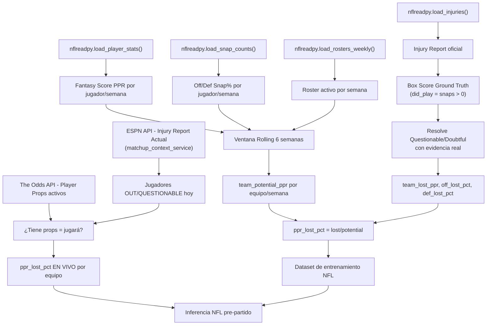
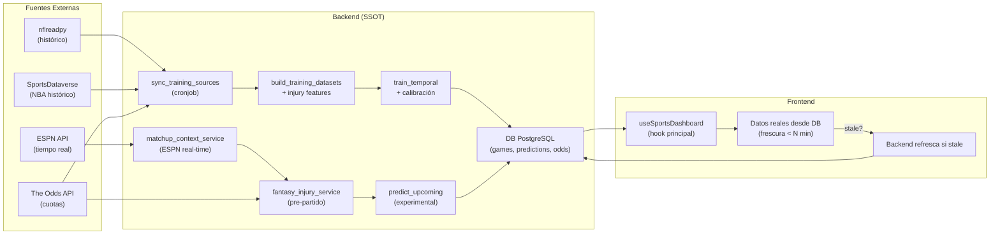
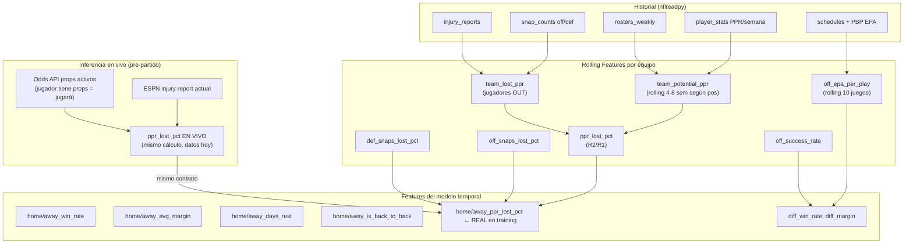

# 🏈 Griddio Sports Analytics — Plan de Auditoría y Refactorización v2.0

> **Rol:** Senior Data Scientist + Auditor de Arquitectura ML  
> **Fecha:** Octubre 2026 · **Protocolo:** AI_CONTEXT_PROTOCOL.md v1.0.0  
> **Modo:** /plan — Sin cambios de código hasta aprobación explícita

---

## Contexto y Estado Real del Sistema (Basado en Documentación)

### Lo que el sistema YA tiene bien ✅
El pipeline de datos y entrenamiento está más avanzado de lo que parecía en la primera auditoría:

- **Pipeline temporal sin data leak:** `build_temporal_dataset()` procesa por bloque de `game_date` y actualiza el historial solo después — correcto.
- **NBA:** 6,137 partidos reales (SportsDataverse/ESPN), temporadas 2021-22 a 2025-26.
- **NFL:** 4,382 partidos reales (nflverse/nflreadpy), 2010-2026.
- **Injury features:** El `injury_feature_builder.py` existe y está conectado a nflreadpy. El `fantasy_injury_service.py` existe y usa ESPN en tiempo real.
- **Ensamble de 3 modelos:** Sí existe en la **documentación histórica** (CatBoost 45% + XGBoost 35% + Logistic 20%) pero el código actual **solo usa Logistic + HistGradientBoosting** — los modelos originales han sido reemplazados por el pipeline temporal.
- **Provenance completo:** Manifiestos SHA-256, `source`, `source_ref`, `observed_at` en cada fila.
- **Gate de producción:** `production_enabled` existe y estaba en `false` (luego activado según el protocolo de oct 2026).

---

## Problemas Críticos Actualizados y con Contexto Correcto

### 🔴 CRÍTICO #1 — Injury Features: Entrenadas en 0, Inferidas en Real (DATA LEAK FUNCIONAL)

**Esto es el issue más importante del sistema. Aclarando la pregunta del desarrollador:**

El problema no es que los valores existan solo después del entrenamiento. El problema es:

```
ENTRENAMIENTO: ppr_lost_pct = 0.0 SIEMPRE (hardcode en temporal_features.py:124-127)
INFERENCIA:    ppr_lost_pct = VALOR REAL de FantasyInjuryService (líneas 92-123 de inference.py)
```

**¿Qué significa esto?** El modelo aprendió que "cuando ppr_lost_pct=0, hay cierta probabilidad de victoria". Nunca vio valores distintos de 0 durante el entrenamiento. En inferencia, de repente recibe `ppr_lost_pct=0.32` (equipo con su QB fuera). El modelo **no sabe qué hacer con ese valor** — fue entrenado sin variación en esa feature. Es un **data leak de distribución**: el modelo ve en producción distribuciones que nunca vio en entrenamiento.

**La buena noticia:** `injury_feature_builder.py` ya construye datos históricos de lesiones correctamente usando nflreadpy. El fix es:

1. Integrar `build_nfl_historical_injury_features()` en `build_training_datasets.py` para que el entrenamiento incluya valores REALES de `ppr_lost_pct`.
2. Solo cuando el entrenamiento tenga valores reales de lesiones, la inferencia en vivo es válida.

**Estado actual del injury builder:** El builder usa nflreadpy correctamente, con la técnica de Box Score Ground Truth para "Questionable" (si tiene snaps/stats → jugó → ACTIVE). La metodología VBD es sólida y se alinea con best practices 2024-25.

> [!CAUTION]
> **Hasta que `build_training_datasets.py` integre `build_nfl_historical_injury_features()`, las injury features NO deben usarse en inferencia**. Actualmente producen un mismatch de distribución que puede sesgar las probabilidades del modelo sin que el sistema lo detecte.

---

### 🔴 CRÍTICO #2 — Parlay Service: Fallback con Datos Inventados

**Archivo:** [`parlay_service.py`](file:///c:/Users/samuel/Documents/Progreso/griddio-sports-analytics/backend/app/services/parlay_service.py#L176-L182)

```python
# ❌ Si la DB tiene menos de 2 candidatos, se inyectan probabilidades INVENTADAS
if len(candidates) < 2:
    candidates = [
        {"team_name": "Boston Celtics", "prob_model": 0.73, ...},  # INVENTADO
    ]
```

Viola directamente la Regla de Oro del protocolo: *"Ningún dato fabricado en ningún endpoint"*. El fix es simplemente retornar lista vacía con mensaje honesto.

---

### 🔴 CRÍTICO #3 — `generate_nfl_matchup_analytics()` se llama para NBA también

**Archivo:** [`predictions.py`](file:///c:/Users/samuel/Documents/Progreso/griddio-sports-analytics/backend/app/api/v1/predictions.py#L159)

```python
analytics = generate_nfl_matchup_analytics(...)  # ← siempre, incluso para sport=NBA
```

`sigma_nfl = 13.5` es la desviación de márgenes NFL. Para NBA sería ~11-12 pts. Los spreads proyectados para partidos NBA son incorrectos. Falta `generate_nba_matchup_analytics()`.

---

### 🔴 CRÍTICO #4 — Frontend: Datos Inventados Presentados como Reales

| Componente | Problema | Gravedad |
|---|---|---|
| `AiMatchupSimulatorCard.tsx` | "Tabla Simulada 10k iteraciones" hardcodeada | 🔴 |
| `StandingsTableCard.tsx` | Clasificación 2023-24 fija, dropdown sin función | 🔴 |
| `MvpOfTheDayCard.tsx` | "Nikola Jokić / Mahomes" + "Confiabilidad 98%" fijo | 🔴 |
| `MetricsGrid.tsx` | "228.4 Pts", "108.4 Efic. neta" hardcodeados | 🟠 |
| `MatchupSimulator.tsx` | Llama endpoint 503 sin manejar el estado | 🟠 |
| `HeroSpotlight.tsx` | Menciona "CatBoost + XGBoost" que no existen en producción | 🟠 |

---

## Respuestas a las Preguntas del Desarrollador

### Pregunta 1: Prioridad de APIs vs DB vs Frontend

**Entendido y de acuerdo.** El flujo correcto es:

```
API Externa → Backend (ingesta) → DB (SSOT) → API interna → Frontend
```

**Regla de frescura por componente:**
- Frontend consulta DB primero siempre
- Si los datos tienen más de `N` minutos/horas de antigüedad, el backend los refresca desde la API externa
- Si el backend no puede refrescar (timeout, rate limit), sirve los datos viejos con timestamp de última actualización visible al usuario

**Para Standings específicamente:** Se puede calcular desde la DB local usando los resultados de partidos ya almacenados (`SELECT team, COUNT(*) as wins FROM games WHERE home_win=1...`). No se necesita un endpoint externo adicional mientras tengamos los juegos en DB.

---

### Pregunta 2: ¿`feature_pipeline.py` es útil?

**Respuesta después de analizar toda la documentación:**

`feature_pipeline.py` define 36 features NBA avanzadas (`H_WPCT`, `H_OFF_RTG`, `H_DEF_RTG`, `ALTITUDE_ADVANTAGE`, etc.) que son **conceptualmente superiores** a las features temporales actuales del modelo. Sin embargo:

- **No está conectado al pipeline de entrenamiento** — es código huérfano
- Las features que define (Off Rtg, Def Rtg, Pace, Net Rtg) **son más informativas** que las que usa el modelo actual (`fg_pct`, `offensive_rebounds`, `total_rebounds`, `turnovers`)
- El modelo actual NBA usa 4 estadísticas básicas + rolling de ventana. `feature_pipeline.py` usa 36 features con interacciones matemáticas específicas (fatiga, B2B, altitud)

**Decisión recomendada:** No eliminar, sino **conectar y evolucionar**. El plan incluye una fase para evaluar si estas features mejoran el AUC del modelo NBA y decidir empíricamente con métricas.

---

### Pregunta 3: Injury Features — Clarificación

**Tu intuición es correcta:** Los valores de lesión histórica solo existen en el boxscore *después* del partido. El `injury_feature_builder.py` construye, correctamente, un registro `(season, week, team, ppr_lost_pct)` que representa qué producción perdió el equipo **antes de ese partido** (basado en la última semana de stats de los jugadores que no aparecieron en el box score).

**El truco del Box Score Ground Truth que mencionas:** Nflreadpy tiene el reporte de lesiones y el boxscore. Si un jugador aparece como "Questionable" pero tiene snaps/puntos en el boxscore de ese partido → jugó (ACTIVE). Si no tiene nada → OUT. Esto está correctamente implementado en `injury_feature_builder.py` líneas 80-97.

**El fix concreto es:** Conectar `build_nfl_historical_injury_features()` al dataset de entrenamiento para que el modelo aprenda a usar esos valores, no solo ponerlos en cero.

---

## Diseño del NFL Fantasy Impact Model (Visión Completa)

### Arquitectura Propuesta



### Métricas de Fantasy Impact — Lo que Griddio hace bien vs. mejoras

**Actualmente bien implementado ✅:**
- Rolling window PPR de 6 semanas (apropiado para capturar tendencia reciente)
- Box Score Ground Truth para Questionable/Doubtful histórico
- VBD dinámico: `ppr_lost_pct = team_lost_ppr / team_potential_ppr`
- Correlación con odds de casas (props activas = jugador jugará)

**Mejoras recomendadas según best practices 2024-25 🔧:**

1. **Rolling adaptativo por posición:**
   - QB: ventana 4 semanas (impacto inmediato, alta varianza)
   - WR/TE: ventana 6-8 semanas (acumulación de rol)
   - RB: ventana 3 semanas (comités rotativos, cambios de uso rápidos)
   - Líneas ofensivas/defensivas: ventana 8 semanas (tendencias más estables)

2. **Replacement Level Value (RLV) por posición:**
   En lugar de contar jugadores como unidades iguales, valorar según posición:
   ```python
   POSITION_MULTIPLIERS = {
       "QB": 2.5,   # Impacto desproporcionado en el sistema
       "WR": 1.0,   # Estándar PPR
       "RB": 1.2,   # Criticidad en rushing/recepción  
       "TE": 0.9,   # Reemplazable con TE2
       "OL": 0.5,   # Impacto difuso, requiere múltiples bajas
   }
   ```
   Esto resuelve el problema del QB que describes: si un equipo históricamente no sufre la baja de su QB (por ejemplo, tiene un RB dominante que no depende del pase), el modelo lo capturará porque el `ppr_lost_pct` del QB será bajo relativamente al `team_potential_ppr`.

3. **Momentum de tendencia (lo que describes como "curva de rendimiento"):**
   ```python
   # Slope de regresión lineal sobre rolling window → tendencia creciente o decreciente
   rolling_slope = player.rolling(6).apply(lambda x: np.polyfit(range(len(x)), x, 1)[0])
   ```
   Un jugador con slope positivo (en alza) tiene más impacto que su promedio de 6 semanas.

4. **Team Impact Score (TIS) — El corazón del sistema:**
   Para un partido futuro dado:
   ```python
   TIS = SUM(player_ppr_rolling * position_multiplier * (1 + slope_factor))
   # Solo jugadores confirmados OUT o con alta probabilidad de baja
   ppr_lost_pct = team_lost_TIS / team_total_TIS
   ```

---

## Plan de Acción en 4 Sprints

### 🚀 Sprint 1 — Erradicación de Datos Falsos en Frontend (Semana 1)

> **Criterio de aceptación:** Ningún componente muestra datos inventados sin disclaimer visible

| # | Acción | Archivo | Tipo |
|---|---|---|---|
| 1 | Eliminar fallback hardcodeado en parlay_service | `parlay_service.py:176-182` | MODIFY |
| 2 | Eliminar "Tabla Simulada 10k iteraciones" de `AiMatchupSimulatorCard` | `AiMatchupSimulatorCard.tsx` | MODIFY |
| 3 | Refactorizar `MvpOfTheDayCard` → `TopPickCard` | `MvpOfTheDayCard.tsx` | MODIFY |
| 4 | `StandingsTableCard`: calcular desde DB o mostrar skeleton honesto | `StandingsTableCard.tsx` + NEW endpoint | MODIFY/NEW |
| 5 | `MetricsGrid`: reemplazar valores hardcodeados por métricas reales de picks | `MetricsGrid.tsx` | MODIFY |
| 6 | `HeroSpotlight`: Corregir texto de modelos falsos | `HeroSpotlight.tsx` | MODIFY |
| 7 | `MatchupSimulator`: mostrar estado del modelo antes de formulario | `MatchupSimulator.tsx` | MODIFY |

**Diferencia clave para `StandingsTableCard`:** En lugar de eliminar, calculamos standings desde la DB:
```sql
SELECT team_id, name, 
  SUM(CASE WHEN home_win = 1 THEN 1 ELSE 0 END) as wins,
  SUM(CASE WHEN home_win = 0 THEN 1 ELSE 0 END) as losses
FROM games JOIN teams ON games.home_team_id = teams.id
WHERE sport = 'NBA' AND season = '2026-27'
GROUP BY team_id, name
```
Endpoint: `GET /api/v1/games/standings?sport=NBA&conference=all`

**Para `MetricsGrid`:** Los 4 tiles se convierten en:
1. `totalMatches` desde `gamesQuery` — ya real ✅
2. `PREMIUM picks hoy` desde `predictionsQuery.data.premium`
3. `EV promedio` = media de `ev_dolares` de picks con ventaja
4. `upcomingCount` desde `gamesQuery` — ya real ✅

---

### 🚀 Sprint 2 — Integración Injury Features en Entrenamiento (Semana 2)

> **Criterio de aceptación:** El modelo NFL se entrena con `ppr_lost_pct` reales; la inferencia en vivo es válida.

| # | Acción | Archivo | Tipo |
|---|---|---|---|
| 8 | Integrar `build_nfl_historical_injury_features()` en `build_training_datasets.py` | `build_training_datasets.py` | MODIFY |
| 9 | Añadir join `(season, week, team) ← injury_features` en el dataset builder | `build_training_datasets.py` | MODIFY |
| 10 | Verificar que `temporal_features.py` incluye `{side}_ppr_lost_pct` en `feature_columns()` con valores reales | `temporal_features.py` | VERIFY |
| 11 | Reentrenar modelos NFL con injury features activas | `train_temporal.py` | RUN |
| 12 | Crear endpoint `GET /api/v1/games/standings` | NEW endpoint | NEW |

**Corrección del mismatch en `build_training_datasets.py`:**
```python
# Antes: injury features = 0.0 siempre
# Después:
from ml.data_pipeline.injury_feature_builder import build_nfl_historical_injury_features

def _attach_injury_features(df: pd.DataFrame, seasons: list) -> pd.DataFrame:
    injury_df = build_nfl_historical_injury_features(seasons)
    # Mapear (season, week) → (game_date con merge_asof)
    # Para evitar leak: injury report de la semana anterior al partido
    ...
```

---

### 🚀 Sprint 3 — Correcciones Backend y Calibración (Semana 2-3)

| # | Acción | Archivo | Prioridad |
|---|---|---|---|
| 13 | Crear `generate_nba_matchup_analytics()` con sigma NBA | `sports_analytics_service.py` | 🔴 |
| 14 | En `/predictions/today`: usar analytics correcto según sport | `predictions.py` | 🔴 |
| 15 | `debug=True` → derivar de `settings.APP_ENV` | `main.py` | 🟠 |
| 16 | Corregir timezone hardcodeada UTC-4 → `ZoneInfo('America/New_York')` | `predictions.py` | 🟠 |
| 17 | Añadir `CalibratedClassifierCV(method='isotonic', cv=5)` al training | `train_temporal.py` | 🟠 |
| 18 | Corregir floor `0.005` en Monte Carlo → `0.0` | `monte_carlo.py` | 🟡 |
| 19 | Eliminar código muerto en líneas 124-125 de `train_temporal.py` | `train_temporal.py` | 🟡 |
| 20 | `kellyFraction` del store → pasar como param en EV/Parlay calls | `useAppStore.ts`, `api.ts` | 🟡 |

**Implementación `generate_nba_matchup_analytics()`:**
```python
# NBA-specific parameters (research-validated)
sigma_nba = 11.5  # NFL=13.5, NBA tiene menor dispersión de márgenes
sigma_totals_nba = 20.3  # Totales NBA tienen mayor varianza

def generate_nba_matchup_analytics(...):
    # Misma estructura que NFL pero con sigma NBA
    # Sin usar play-by-play EPA (NFL-specific)
    # Usando OffRtg / DefRtg / NetRtg en lugar de spread EPA
```

**Calibración Post-hoc:**
```python
from sklearn.calibration import CalibratedClassifierCV

# En train_temporal.py
def _models():
    return {
        "logistic": make_pipeline(
            StandardScaler(),
            CalibratedClassifierCV(
                LogisticRegression(max_iter=2000),
                cv=5, method='isotonic'
            )
        ),
        "hist_gradient_boosting": CalibratedClassifierCV(
            HistGradientBoostingClassifier(
                max_iter=200, learning_rate=0.06, l2_regularization=1.0
            ),
            cv=5, method='isotonic'
        ),
    }
```

> [!IMPORTANT]
> La calibración requiere reentrenamiento de los modelos y actualización de `model_metadata.json`. Los `.joblib` actuales se invalidan. Es necesario correr el pipeline completo de sincronización → entrenamiento → scoring experimental antes de re-activar producción.

---

### 🚀 Sprint 4 — NFL Fantasy Model Mejorado y NBA Feature Pipeline (Semana 3-4)

| # | Acción | Archivo | Prioridad |
|---|---|---|---|
| 21 | Añadir `POSITION_MULTIPLIERS` y `rolling_slope` al injury builder | `injury_feature_builder.py` | 🟠 |
| 22 | Conectar `feature_pipeline.py` al pipeline NBA con evaluación empírica | `feature_pipeline.py` + `nba_source.py` | 🟠 |
| 23 | Optuna para hyperparameter tuning (reemplaza valores fijos) | `train_temporal.py` | 🟡 |
| 24 | Calcular `sigma_nfl` dinámicamente desde DB | `sports_analytics_service.py` | 🟡 |

**Para el Sprint 4 — Evaluación empírica de `feature_pipeline.py`:**

El plan es correr A/B training:
- **Modelo A:** Features actuales temporales (`fg_pct`, `offensive_rebounds`, etc.)
- **Modelo B:** `feature_pipeline.py` features (`H_OFF_RTG`, `V_DEF_RTG`, `ALTITUDE_ADVANTAGE`, etc.) con los mismos folds temporales

Si el Modelo B tiene AUC > Modelo A por más de 0.005 con intervalos de confianza no solapados → conectar. Si no → mantener el pipeline simple y documentar `feature_pipeline.py` como experimental/descartado.

---

## Arquitectura de Datos — Flujo Correcto (Actual → Propuesto)



---

## Diagrama de Features NFL (Propuesto)



---

## Self-Audit del Plan v2.0

### ¿Qué puede fallar en este plan?

**A. Sprint 2: Alinear semanas NFL con game_date del modelo**

El `injury_feature_builder.py` trabaja en `(season, week)` pero el modelo temporal trabaja en `game_date`. La semana NFL empieza normalmente el jueves o viernes. El merge entre semanas y fechas necesita un `merge_asof` cuidadoso para no introducir leak: el injury report de la semana N solo puede usarse para partidos en la semana N, no antes.

**Fix:** Usar `gameday` del schedule nflreadpy para mapear `(season, week)` → `game_date` exacta del partido, luego hacer join directo.

**B. Sprint 3: Calibración con CalibratedClassifierCV requiere mínimo de muestras**

`CalibratedClassifierCV(cv=5)` necesita al menos 5 folds de calibración con datos distintos al entrenamiento. Con 6,137 filas NBA y ~1,200 por fold, es suficiente. Con NFL 4,382 y ~876 por fold, también funciona. ✅

**C. `feature_pipeline.py` para NBA requiere datos de Off Rtg / Def Rtg**

El pipeline actual NBA usa `fg_pct, offensive_rebounds, total_rebounds, turnovers` desde SportsDataverse. El `feature_pipeline.py` necesita `H_OFF_RTG` y `H_DEF_RTG` que son métricas de 100 posesiones — no están en el dataset actual. **Tendríamos que agregar estas columnas desde la fuente o calcularlas.**

NBA Offensive Rating = `PTS / Possessions * 100`
Possessions ≈ `FGA - OREB + TOV + 0.44 * FTA`

Si el boxscore de SportsDataverse incluye `PTS, FGA, OREB, TOV, FTA` por equipo → podemos calcular Rtg. Si no → es código sin datos.

> [!IMPORTANT]
> **Pregunta abierta para el desarrollador (precisa):** ¿El boxscore de SportsDataverse que ya descargamos incluye las columnas `PTS, FGA, OREB, FTA, TOV` por equipo? Si es así, puedo conectar `feature_pipeline.py`. Si no, queda como deuda técnica para cuando tengamos acceso a esos datos.
> **Contexto:** `nba_source.py` actualmente usa: `fg_pct, offensive_rebounds, total_rebounds, turnovers` — por ende FGA/FTA/PTS probablemente sí están disponibles en el raw.

**D. El Sprint 1 (frontend) puede hacer que el dashboard parezca vacío si no hay picks**

Si eliminamos los fallbacks hardcodeados y la DB tiene 0 picks (porque `production_enabled=false` según el handoff), el dashboard quedaría completamente vacío. 

**Fix:** El Sprint 1 también debe incluir estados vacíos honestos y elegantes para cada componente — no solo eliminar datos falsos sino diseñar los skeletons/empty states.

**E. Sigma NFL hardcodeada (13.5) en Sprint 3 — Dónde calcularla**

La DB puede no tener suficientes partidos completados al inicio de la temporada para calcular una sigma confiable. La solución: calcular sigma de temporadas históricas (2018-2025), persistirla en un config o tabla, y actualizarla al cierre de cada temporada. Durante la temporada activa, usar la sigma histórica hasta tener mínimo 50 partidos del año actual.

**F. Dependency entre Sprint 2 y producción**

El Sprint 2 requiere reentrenar los modelos. Hasta que el reentrenamiento termine y se valide, `production_enabled` debe volver a `false`. Plan:
1. Realizar cambios en Sprint 2
2. Correr pipeline completo de sync → build → train
3. Evaluar métricas con injury features vs. sin ellas
4. Si mejoran o se mantienen → reactivar producción

---

## Verificación del Plan

### Tests Automatizados

```bash
# Después de cada sprint
cd backend
python -m pytest tests/ -v --tb=short

# Sprint 1: verificar que parlay retorna vacío
python -m pytest tests/ -k "parlay" -v

# Sprint 2: verificar integración de injury features
python -m pytest tests/test_temporal_pipeline.py -v

# Sprint 3: verificar que analytics NBA usa sigma correcta
python -m pytest tests/test_nfl_analytics.py -v

# Pipeline completo post-Sprint 2
PYTHONPATH=backend python backend/scripts/build_training_datasets.py --sport nfl
PYTHONPATH=backend python backend/ml/training/train_models.py --sport nfl
```

### Verificación Manual

1. **Sprint 1:** Con backend corriendo, verificar que el dashboard muestra estados vacíos honestos (no datos inventados) cuando no hay picks
2. **Sprint 2:** Después de reentrenar NFL, verificar en `model_metadata.json` que `features` incluye `home_ppr_lost_pct` con valores > 0 en el dataset
3. **Sprint 3:** Llamar `/api/v1/predictions/today?sport=NBA` y verificar que el analytics no menciona "NFL" ni usa sigma 13.5

---

## Preguntas Abiertas (Precisas)

> [!IMPORTANT]
> **P1 — Columnas del boxscore NBA en SportsDataverse:**  
> ¿El archivo Parquet que descarga `nba_source.py` incluye columnas de puntos (`team_pts`), intentos de campo (`team_fga`), tiros libres intentados (`team_fta`) además de `fg_pct, offensive_rebounds, total_rebounds, turnovers`?  
> **Por qué importa:** Con esas columnas puedo calcular OffRtg/DefRtg y conectar `feature_pipeline.py` al pipeline NBA. Sin ellas, esas 36 features no son calculables.

> [!IMPORTANT]
> **P2 — Temporada NFL 2026: semanas jugadas actualmente:**  
> El handoff menciona datos hasta 2026-09-28 (semana ~4). ¿Cuántas semanas van en la temporada actual? ¿Ya hay datos de snaps/stats de esta temporada en nflreadpy para las primeras semanas?  
> **Por qué importa:** Para saber si el modelo puede hacer predicciones inmediatas con features de lesiones reales de la temporada en curso, o si necesitamos esperar a que nflreadpy actualice.

> [!CAUTION]
> **P3 — ¿Reactivar producción durante el Sprint 2?**  
> El handoff documenta que `production_enabled=true` fue activado el 2026-10-08. Si hacemos cambios en Sprint 2 (integrar injury features), los modelos `.joblib` actuales son incompatibles con el nuevo contrato de features. ¿Volvemos a `false` durante la refactorización y aceptamos el downtime del dashboard, o mantenemos los modelos sin injury features hasta terminar Sprint 2 completo?  
> **Recomendación:** Mantener producción activa con los modelos actuales (sin injury features) mientras desarrollamos Sprint 2 en paralelo, luego hacer el switch tras validar métricas del nuevo entrenamiento.
