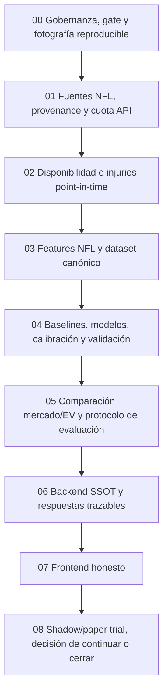

# NFL Model: plan de ejecución y control

**Versión:** 1.0  
**Fecha de preparación:** 2026-10-11  
**Estado:** Borrador final para revisión; desarrollo aún no iniciado por este documento.
**Alcance inmediato:** NFL únicamente.  
**Ejecutor de fases:** Gemini, una fase a la vez.  
**Orquestador y revisor de aceptación:** Codex.  
**Autoridad final sobre apuestas y gasto:** Samuel.

## Propósito

Este paquete convierte la auditoría en instrucciones secuenciales que otro agente pueda ejecutar sin reconstruir el contexto de la conversación. Cada fase define objetivo, pasos, archivos de referencia, entregables, controles de datos, pruebas y condiciones para avanzar. Gemini debe dejar evidencia y actualizar el estado compartido al cerrar cada fase.

La regla de producto es estricta: **el backend es la única fuente de datos y cálculos deportivos; el frontend solo solicita, formatea y presenta respuestas reales del backend**. Si faltan datos, la respuesta es `unavailable` con causa; no se inventan equipos, probabilidades, cuotas, rankings, ROI ni valores sustitutos.

La filosofía “Gana o muere” se convierte en reglas de decisión observables: no pagar fuentes premium antes de demostrar utilidad con datos disponibles; establecer de antemano muestra, métricas, límites de pérdida y créditos; y cerrar o archivar el proyecto/modelo cuando falle la prueba confirmatoria. No se promete rentabilidad ni se reabre un holdout fallido para volver a ajustarlo.

## Alcance y límites

### Incluido ahora

- NFL: moneyline como primer mercado de predicción y evaluación.
- Datos de calendario, resultados, play-by-play, estadísticas de jugador, lesiones, snaps, rosters y disponibilidad prepartido.
- Comparación de probabilidades del modelo con el mercado sin vig y cálculo de EV solo a precios observados y vigentes.
- Ingesta/persistencia con provenance, límites de The Odds API, API de backend y estados honestos de frontend.
- Experimento de modelos base y ensemble solo si los datos y validación justifican su uso.
- Prueba operativa con predicciones guardadas y apuestas registradas manualmente por el usuario; nunca automatizar apuestas.

### Fuera del alcance actual

- NBA, sus APIs estacionales, sus features, props y decisiones de disponibilidad. Se abrirá después del inicio de temporada y con un plan independiente.
- Comprar suscripciones o datos premium. Requiere evidencia previa y decisión del usuario.
- Scraping no autorizado, datos fabricados o inferir participación como certeza a partir de que no haya una prop listada.
- Prometer “ventaja matemática” por accuracy, AUC o una simulación aislada.

## Orden obligatorio

No se empieza una fase hasta que Codex marque la aceptación de la fase anterior en [EXECUTION_STATE.md](EXECUTION_STATE.md). Una fase fallida vuelve a `in_progress` o `blocked` con causa; no se marca `done` con pruebas omitidas.

## Índice de documentos

| Documento | Contenido |
|---|---|
| [EXECUTION_STATE.md](EXECUTION_STATE.md) | Estado único, evidencia y siguiente acción |
| [GEMINI_HANDOFF.md](GEMINI_HANDOFF.md) | Instrucciones para cada sesión del ejecutor |
| [00-governance.md](00-governance.md) | Gate, baseline, alcance, riesgo y reglas para avanzar |
| [01-data-and-quota.md](01-data-and-quota.md) | Fuentes, snapshots, catálogo inicial y economía de API |
| [02-injury-point-in-time.md](02-injury-point-in-time.md) | ESPN, props como señal, boxscore como etiqueta y ausencia |
| [03-features-and-dataset.md](03-features-and-dataset.md) | Contrato NFL, features propuestas, leakage y dataset |
| [04-model-validation.md](04-model-validation.md) | Baselines, ensemble, folds, calibración y métricas |
| [05-market-and-ev.md](05-market-and-ev.md) | Mercado sin vig, precios ejecutables, EV, CLV y backtest |
| [06-backend-contract.md](06-backend-contract.md) | Jobs, persistencia, API, freshness y fail-closed |
| [07-frontend.md](07-frontend.md) | Purga global de valores ficticios y UI solo consumidora |
| [08-operational-trial.md](08-operational-trial.md) | Shadow/paper trial, límites, kill criteria y decisión final |
| [DATA_DICTIONARY.md](DATA_DICTIONARY.md) | Registro de campos, fuentes, timestamp y uso permitido |

## Bloqueos ya conocidos que Gemini debe verificar primero

1. El protocolo actual exige `production_enabled: false` mientras no haya revisión de calidad/calibración/provenance, pero los metadata NFL/NBA dicen `true`. Para esta iniciativa NFL se debe cerrar el gate antes de reconstruir artefactos.
2. `backend/ml/training/train_temporal.py` contiene `"production_enabled": true` en minúsculas. En Python esto no es un booleano y puede impedir escribir metadata.
3. `build_training_datasets.py` ya llama a `build_nfl_historical_injury_features`; no repetir como trabajo pendiente el cableado básico. La auditoría debe arreglar semántica temporal, provenance y nulos.
4. El builder de lesiones carga `player_stats`, snaps, injuries y rosters directamente desde `nflreadpy` y no los agrega al manifest de snapshots de entrenamiento.
5. El builder usa participación observada en el boxscore del mismo juego para resolver bajas históricas. Eso solo puede ser etiqueta/ground truth de disponibilidad, nunca feature prepartido del modelo ganador.
6. `FantasyInjuryService` no recibe listas de props desde `inference.py`; sus valores heurísticos no implementan la política de mercado descrita por el usuario. La ausencia de lesión o de props puede terminar como cero/default.
7. El metadata de entrenamiento mide winner prediction, no rentabilidad contra Vegas. No existe evidencia actual de EV/ROI positivo.
8. `chronological_folds()` deja que el último fold de validación continúe dentro del holdout final; corregirlo antes de usarlo para selección de modelo.
9. El clasificador NFL usa una sola salida de ganador local/visitante; Logistic y HistGradientBoosting son artefactos comparados, no un ensemble validado.
10. El frontend tiene fuentes de prueba/valores estáticos. Existe un fallback de parlays con picks inventados y simulador con tabla fija.

Los archivos y líneas pueden cambiar. Gemini debe volver a comprobarlos en el checkout y anotar los números de línea actuales en su reporte, sin dar por vigente esta lista solo por estar aquí.

## Condición global de salida

No se habilita producción hasta cumplir todas estas condiciones:

- Los snapshots de cada input usado están identificados, con hash y timestamp anterior al corte.
- Entrenamiento e inferencia usan el mismo contrato y semántica de features.
- El modelo se compara en holdout cronológico no usado para selección contra un baseline de mercado no-vig.
- Las métricas de probabilidad, calibración y precios ejecutables se reproducen desde manifests identificados.
- No se informa EV si el precio está vencido, no se puede identificar el sportsbook/mercado, falta una entrada obligatoria o la inferencia no está aprobada.
- Los cálculos viven en backend. El frontend nunca sustituye respuestas con datos hardcodeados.
- El trial tiene muestra, horizonte, límites de crédito y de exposición preinscritos.
- El usuario aprueba explícitamente la decisión de producción y el límite de apuesta manual; ningún job hace wagering.

